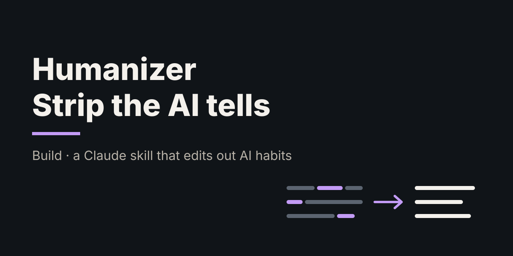
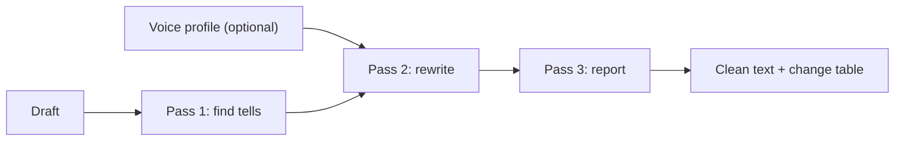

# Humanizer: a Claude skill that strips AI tells from writing

> **TL;DR:** Humanizer is a Claude skill that edits AI-drafted text in three passes: find the tells, rewrite without them, report what changed. The tells it targets aren't folklore. Studies of millions of abstracts show words like "delve" spiked after ChatGPT launched. But no list of tells can prove a text is AI, so the skill aims for writing that reads well, not writing that "passes a detector".

**Spark:** my own Claude skill, [`skill/SKILL.md`](skill/SKILL.md) · **Angle:** build · **Date:** 2026-10-13

## The claim vs. reality

The skill rests on one claim: AI text has recognizable habits, and removing them makes it read like a person wrote it.

- **The habits are real.** Kobak et al. tracked word frequencies in more than 14 million PubMed abstracts and found a sudden excess of style words in 2024; "delves", "underscores" and "showcasing" rose the most relative to their usual frequency. They estimate at least 13.5% of 2024 abstracts were processed with an LLM [1]. Liang et al. used a separate word-frequency method on 1.1 million papers and found LLM-modified text rising to about 22% in computer science [2].
- **Why it happens is less settled.** Juzek and Ward found no evidence that architecture or training data explains the overuse. Their results are consistent with human feedback during fine-tuning (RLHF) rewarding those words, but the evidence is suggestive, not conclusive [3].
- **Tells don't prove anything.** OpenAI pulled its own AI-text classifier in July 2023 after it caught only 26% of AI text and flagged 9% of human text [5]. Detectors also flagged more than half of essays by non-native English writers as AI-generated [4]. Wikipedia's editors frame their own list of signs as clues to weigh together, not proof [6].

So the skill is right about the patterns and careful about what they mean. It edits for readability. It never claims to make text "undetectable".

## How it works

The skill is a single prompt file (`SKILL.md`) that Claude loads when you ask it to humanize a draft.



1. **Find the tells.** It quotes every instance from a catalogue in four groups: rhetorical tics ("here's the thing", "not just X, but Y"), structure tics (back-to-back questions, a colon followed by three items, trailing ", highlighting..." clauses), vocabulary and filler ("delve", "tapestry", "it's important to note") and leftovers (citation markers, tracking parameters).
2. **Rewrite.** The core rule: almost every tell stands in for the actual point, so cut the framing and state the point. It varies sentence length, uses plain words, bans em dashes, and never adds facts, numbers or examples.
3. **Report.** It returns the clean text, a table of every change, anything it deliberately left in, and one honest line on whether the result now reads like a person.

It also reads a **private voice-profile file** with samples of my own writing in two registers (reflective and academic) and matches whichever fits the draft. That file stays out of this repo.

## Deep dive

**Why a catalogue works.** The tells cluster. Kobak et al. found that before 2024, excess words were mostly nouns tied to events; during Covid they were content words like "respiratory" and "remdesivir". In 2024, 66% of the excess style words were verbs and 16% were adjectives (preprint figures), and "delves" appeared 28 times more often than expected [1]. Style words can be removed without changing the meaning, which is exactly what Pass 2 does.

**Why "find" and "rewrite" are separate passes.** Naming each tell with a quote before rewriting forces the model to show what it found, and the report makes the edit easy to audit. If you ask a model to "sound more human" in one step, it tends to swap one cliché for another. The skill bans that outright.

**What the skill refuses to do.** Two rules stand out. First, "if the draft is already clean, say so and change nothing". This guards against an editor inventing problems to look busy. Second, "do not add new claims". This guards against humanizing by inventing anecdotes, a common way AI rewrites quietly introduce false details.

**Where it falls short.** A tell list is a moving target. Juzek and Ward point to fine-tuning preferences as a likely cause [3], so new model versions may favour new words. The vocabulary list needs updating as models change. And because detectors penalize plain, predictable prose [4], cutting fancy words can make text look *more* machine-like to a perplexity-based detector. That's one more reason not to treat detectors as the goal.

## Apply it

`code/tells.py` automates Pass 1. It is standard-library Python with regexes for each item in the catalogue and a few sentence-level checks. It prints every tell with the quoted phrase and exits non-zero if it finds any, so it can serve as a pre-publish check.

```bash
cd code
python3 tells.py samples/ai_draft.txt samples/humanized.txt
```

Real output (the draft is a deliberately tell-heavy paragraph; the second file is a hand rewrite following Pass 2):

```
== samples/ai_draft.txt: 101 words, 18 tells (17.8 per 100 words)
  [rhetorical ] not just X, but Y            "not just a trend, but"
  [rhetorical ] here's the thing/catch/kicker "Here's the thing"
  [rhetorical ] turns out                    "Turns out"
  [rhetorical ] X is dead                    "office isn't dead"
  [vocabulary ] LLM-favoured word            "delve"
  [vocabulary ] LLM-favoured word            "meticulous"
  [vocabulary ] LLM-favoured word            "vibrant"
  [vocabulary ] it's important/worth noting  "It's important to note"
  [vocabulary ] plays a crucial role         "plays a crucial role"
  [vocabulary ] fast-paced world             "In today's fast-paced world"
  [vocabulary ] unnamed authority            "experts argue"
  [vocabulary ] challenges remain            "Despite these challenges"
  [vocabulary ] challenges remain            "remains to be seen"
  [punctuation] em dash                      "—"
  [structure  ] back-to-back questions       "Why does this matter?"
  [structure  ] colon + triad                ": trust, tools, and rhythm."
  [structure  ] participle tail              ", fostering a vibrant culture."
  [structure  ] stranded auxiliary           "The commute is"
  by category: punctuation 1, rhetorical 4, structure 4, vocabulary 9

== samples/humanized.txt: 94 words, 0 tells (0.0 per 100 words)
```

To use the skill itself, copy `skill/SKILL.md` into a folder named `humanizer` under `~/.claude/skills/` (Claude Code) or upload it as a custom skill in Claude. Then paste a draft and ask Claude to humanize it. The skill's voice-profile section refers to a `references/voice-samples.md` file; add your own writing samples there, or delete that section.

## Takeaways

- Treat AI tells as editing targets, not evidence. The research shows the patterns exist, and it also shows detectors built on them misfire.
- Most tells are framing in place of a claim. Deleting the framing and stating the claim fixes most of them.
- Keep detection and rewriting separate: a cheap script finds the patterns, and judgement does the rewrite.
- Ban new facts during a style edit. That rule matters more than any word list.
- Revisit the word list as models change, since the overused words probably come from fine-tuning preferences that shift between versions.

## Open questions

- How fast does the tell vocabulary drift between model versions? Rerunning `tells.py` on output from each new model would show it.
- Does the skill's output score differently on perplexity-based detectors than the original draft? Plainer prose might score *more* AI-like [4].
- Can the voice-profile step be measured, for example by comparing sentence-length spread before and after against the samples?

## Sources

1. [Kobak, González-Márquez, Horvát & Lause (2025), "Delving into LLM-assisted writing in biomedical publications through excess vocabulary", *Science Advances* 11(27)](https://doi.org/10.1126/sciadv.adt3813): over 14M PubMed abstracts; at least 13.5% of 2024 abstracts LLM-processed. Preprint: [arXiv:2406.07016](https://arxiv.org/abs/2406.07016).
2. [Liang et al. (2025), "Quantifying large language model usage in scientific papers", *Nature Human Behaviour*](https://doi.org/10.1038/s41562-025-02273-8): 1.1M papers; LLM-modified text up to about 22% in computer science.
3. [Juzek & Ward (2025), "Why Does ChatGPT 'Delve' So Much? Exploring the Sources of Lexical Overrepresentation in Large Language Models", COLING 2025](https://aclanthology.org/2025.coling-main.426/): finds no support for architecture or training data as the cause; results are consistent with RLHF playing a role.
4. [Liang, Yuksekgonul, Mao, Wu & Zou (2023), "GPT detectors are biased against non-native English writers", *Patterns*](https://doi.org/10.1016/j.patter.2023.100779): seven detectors flagged more than half of TOEFL essays as AI.
5. [OpenAI, "New AI classifier for indicating AI-written text" (2023, with July 2023 update)](https://openai.com/index/new-ai-classifier-for-indicating-ai-written-text/): 26% true-positive rate, 9% false-positive rate; withdrawn for low accuracy.
6. [Wikipedia: Signs of AI writing](https://en.wikipedia.org/wiki/Wikipedia:Signs_of_AI_writing): WikiProject AI Cleanup's field guide; an advice page, not policy.
